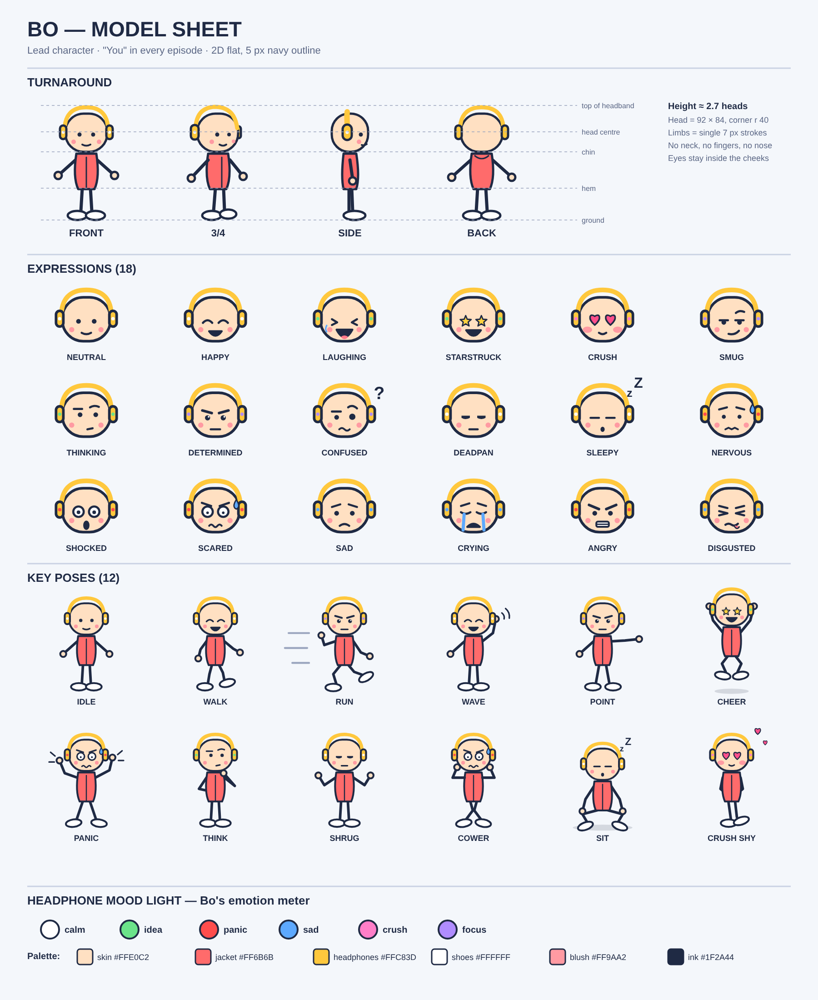
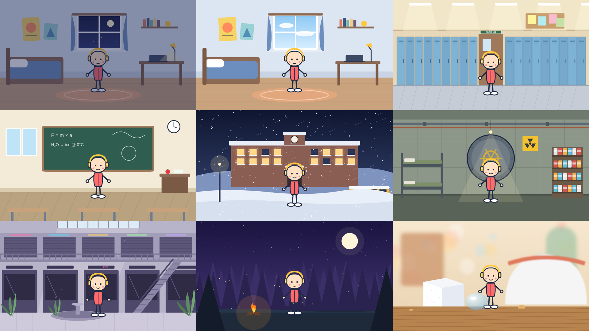

# BO & YOU: 2D animated series kit

An English-language 2D animated YouTube series where **the viewer is Bo**. Two core formats:

- **POV**: *"POV: You're Snowed In at School With Your Crush for 7 Days"*: countdown survival + a crush.
- **WHAT IF**: *"What If You Could Shrink to the Size of an Ant?"*: a superpower vs. real science.
- **HYBRID**: a power + a countdown (season finales).



## Start here

| File | What's in it |
|---|---|
| [`docs/00_SERIES_BIBLE.md`](docs/00_SERIES_BIBLE.md) | Positioning, narration rules, cast (Bo, Rae, Juno, Mr. Pickett, Mom, the Grey Raincoat), visual & sound identity, titles, thumbnails |
| [`docs/01_STORY_ENGINE.md`](docs/01_STORY_ENGINE.md) | The shared spine, **What If** 7-beat structure, **POV** Countdown Ladder, Hybrid, episode cards, variety kit (frames/tones/openings/pattern breaks), selection rules |
| [`docs/02_QA_CHECKLIST.md`](docs/02_QA_CHECKLIST.md) | Pre-upload checklist + fact-check table |
| [`docs/03_PRODUCTION_2D.md`](docs/03_PRODUCTION_2D.md) | Asset tiers, rigging Bo, background stage lines & scale, pipeline, schedule, release plan |
| [`docs/04_EPISODE_LOG.md`](docs/04_EPISODE_LOG.md) | Season 1 plan (8 episodes) + metrics log |
| [`episodes/EP01_POV_Snowed_In_With_Your_Crush/`](episodes/EP01_POV_Snowed_In_With_Your_Crush/) | Pilot: full storyboard (58 shots) + VO script |
| [`episodes/EP02_WHATIF_Shrink_To_Ant_Size/`](episodes/EP02_WHATIF_Shrink_To_Ant_Size/) | Episode 2 beat sheet |

## Art

```
art/
  characters/bo/
    bo_model_sheet.svg        turnaround + 18 expressions + 12 poses + mood light + palette
    expressions/bo_face_*.svg 18 head swaps
    poses/bo_pose_*.svg       12 key poses
    turnaround/bo_*.svg       front, 3/4, side, back
  backgrounds/BG01–BG08_*.svg 1920×1080, layered (sky/far/mid/fg) for parallax
  previews/*.png              rendered previews, incl. Bo placed on every background
tools/
  bo.py, backgrounds.py       source of all art (edit these)
  build_art.py                regenerates art/ (add --png for previews)
```



## Episode delivery convention
```
episodes/EPxx_<FORMAT>_<Slug>/
  STORYBOARD.md  VO_SCRIPT.txt
  shots/ 1.1.mp4 …   vo/ NARR_B1.wav, BO_7.2.wav …   music/   sfx/   thumbs/
```

> The previous Vietnamese 3D version of the project (character "Mầm") is preserved in git history (commit `a8d3bfe`).
